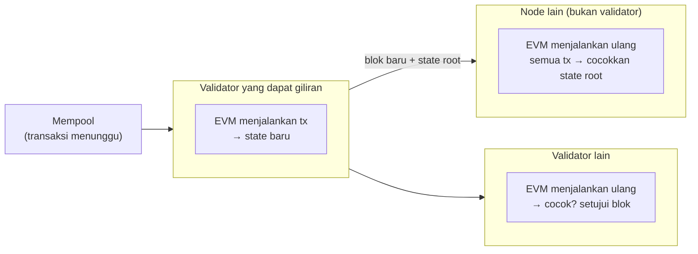

# EVM, Node, dan Validator

Bagian dari [EVM 01 - EVM vs Non-EVM](../EVM%2001%20-%20EVM%20vs%20Non-EVM.md) · ← [EVM 01.12 - Native Token](EVM%2001.12%20-%20Native%20Token.md) · [EVM 01.14 - Execution Client dan Consensus Client](EVM%2001.14%20-%20Execution%20Client%20dan%20Consensus%20Client.md) →

Hasil percobaan untuk materi ini ada di [EVM 01.13 - Hasil Praktik](../Hasil%20Praktik/EVM%2001.13%20-%20Hasil%20Praktik.md).

EVM sering dikira sama dengan node blockchain yang menjadi validator. **Bukan.** Ada tiga hal
yang berbeda:

| Istilah | Apa | Contoh |
| --- | --- | --- |
| **EVM** | program yang menjalankan bytecode kontrak; bagian dari software client | interpreter di dalam geth, reth, client BSC |
| **Node** | komputer yang menjalankan software client: menyimpan state, terhubung ke node lain (P2P), melayani RPC `eth_*` | node RPC publicnode, node yang kamu jalankan sendiri, `anvil` (node lokal tanpa jaringan) |
| **Validator** | node yang punya kunci + stake dan diberi hak membuat dan menyetujui blok | Ethereum: stake 32 ETH per validator; BSC: 45 validator yang dipilih lewat stake BNB |

Jadi EVM ada **di dalam** node, dan validator adalah **peran** yang dipegang sebagian node.
Analogi: EVM = mesin, node = mobil, validator = mobil yang punya izin taksi. Mobil pribadi
memakai mesin yang sama, tapi tidak boleh mengangkut penumpang.

## Semua node menjalankan EVM, bukan cuma validator

Validator membuat blok. Node lain tidak percaya begitu saja: setiap node menjalankan ulang
semua transaksi di blok itu lewat EVM-nya sendiri. Kalau hasil state-nya beda dengan yang
ditulis validator, blok itu ditolak.



Karena itu EVM harus **deterministik**: input yang sama harus menghasilkan output yang sama
di semua node. Ini alasan EVM tidak punya akses internet, jam sistem, atau angka acak
sungguhan (lihat [EVM 01.05 - Environment](EVM%2001.05%20-%20Environment.md)).

| | Node biasa | Validator |
| --- | --- | --- |
| Menjalankan EVM | ya, untuk memeriksa setiap blok | ya, untuk menyusun dan memeriksa blok |
| Menyimpan state | ya | ya |
| Melayani RPC | bisa | bisa (biasanya dimatikan demi keamanan) |
| Menentukan isi dan urutan blok | tidak | ya, saat dapat giliran |
| Butuh stake | tidak | ya |
| Dapat reward | tidak | ya (priority fee, reward blok) |

## Ethereum vs BSC: susunan software node

**Ethereum** memisahkan node menjadi dua program sejak The Merge (2022):

- **Execution client** (geth, reth, Nethermind, Besu, Erigon): berisi EVM, state, mempool,
  dan RPC `eth_*`.
- **Consensus client** (Prysm, Lighthouse, Teku, Nimbus, Lodestar): PoS, memilih rantai
  yang benar, dan menentukan siapa yang membuat blok.
- Keduanya berbicara lewat Engine API (`engine_*`, lihat [EVM 01.11 - RPC eth](EVM%2001.11%20-%20RPC%20eth.md)). Perbedaan
  keduanya dijelaskan di [EVM 01.14 - Execution Client dan Consensus Client](EVM%2001.14%20-%20Execution%20Client%20dan%20Consensus%20Client.md).
- Validator = dua program di atas + **validator client** yang memegang kunci validator.

**BSC** cuma satu program (fork geth) yang menggabungkan eksekusi dan konsensus PoSA.
Daftar validatornya disimpan di **kontrak sistem** `0x0000000000000000000000000000000000001000`,
jadi daftar itu sendiri dijalankan oleh EVM.

## Siapa yang membuat blok: field `miner`

Setiap blok punya field `miner`, tapi artinya beda di Ethereum dan BSC.

- **BSC:** isinya alamat validator yang membuat blok. Satu validator membuat beberapa blok
  berturut-turut per giliran, jadi dalam 20 blok hanya muncul sedikit alamat. Semua pembuat
  blok itu terdaftar di `getValidators()` kontrak sistem `0x…1000`.
- **Ethereum:** isinya *fee recipient*, bukan identitas validator. Sejak MEV-Boost banyak blok
  disusun builder, jadi alamat yang muncul sering milik builder. Alamatnya bahkan bisa
  `0x0000…0000`. Validator Ethereum dikenali lewat *proposer index* di beacon chain, yang tidak
  ada di blok execution (lihat [EVM 01.14 - Execution Client dan Consensus Client](EVM%2001.14%20-%20Execution%20Client%20dan%20Consensus%20Client.md)).

## Coba sendiri

1. Tanyakan software client di balik RPC Ethereum dan RPC BSC dengan `cast client`.
2. Ambil field `miner` dari 20 blok terakhir di kedua chain, lalu hitung berapa alamat berbeda.
3. Panggil `getValidators()` di kontrak sistem BSC dan cocokkan dengan pembuat blok tadi.

```bash
cast client --rpc-url https://ethereum-rpc.publicnode.com
cast client --rpc-url https://bsc-dataseed.bnbchain.org
cast block <nomor> --field miner --rpc-url <rpc>
cast call 0x0000000000000000000000000000000000001000 "getValidators()(address[])" --rpc-url <rpc-bsc>
cast codesize 0x0000000000000000000000000000000000001000 --rpc-url <rpc-bsc>
```

---

Bagian dari [EVM 01 - EVM vs Non-EVM](../EVM%2001%20-%20EVM%20vs%20Non-EVM.md) · ← [EVM 01.12 - Native Token](EVM%2001.12%20-%20Native%20Token.md) · [EVM 01.14 - Execution Client dan Consensus Client](EVM%2001.14%20-%20Execution%20Client%20dan%20Consensus%20Client.md) →
