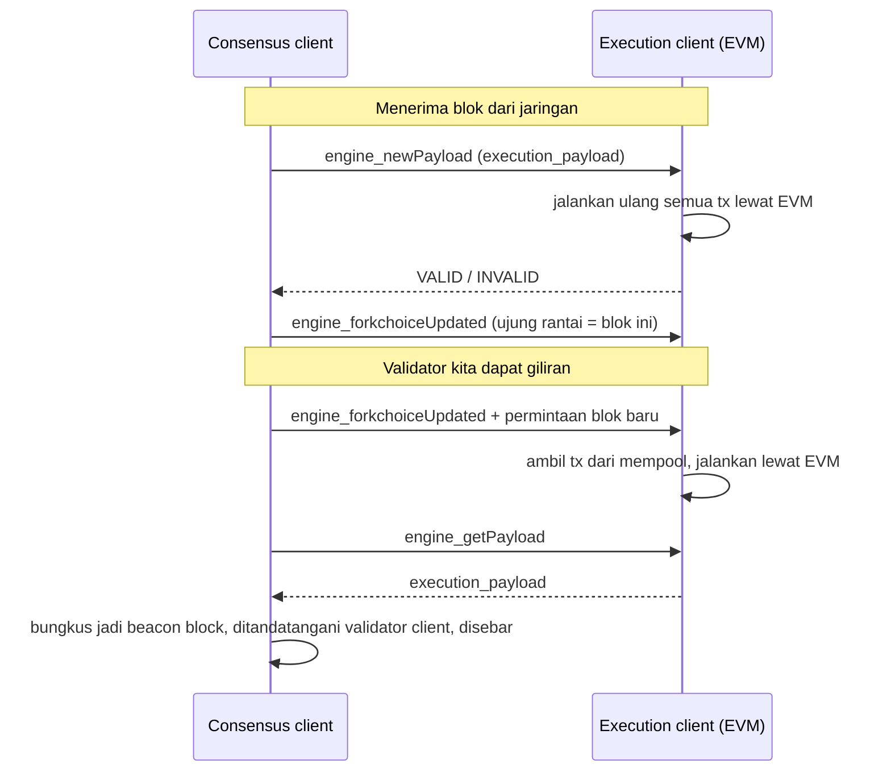

# Execution Client dan Consensus Client

Bagian dari [EVM 01 - EVM vs Non-EVM](../EVM%2001%20-%20EVM%20vs%20Non-EVM.md) · ← [EVM 01.13 - EVM, Node, dan Validator](EVM%2001.13%20-%20EVM%2C%20Node%2C%20dan%20Validator.md) · [EVM 01.15 - Validator Client](EVM%2001.15%20-%20Validator%20Client.md) →

Hasil percobaan untuk materi ini ada di [EVM 01.14 - Hasil Praktik](../Hasil%20Praktik/EVM%2001.14%20-%20Hasil%20Praktik.md).

**Execution client** mengurus **isi** blok: menjalankan transaksi lewat EVM dan menyimpan
state. **Consensus client** mengurus **blok mana yang sah**: siapa yang boleh membuat blok,
blok mana yang disetujui mayoritas validator, dan kapan blok jadi final.

Analogi: execution client = akuntan yang menghitung saldo dari setiap transaksi. Consensus
client = rapat yang memutuskan buku besar mana yang resmi dan siapa yang mencatat giliran
berikutnya. Akuntan tidak bisa memutuskan buku mana yang resmi, dan rapat tidak menghitung
saldo.

Sejak The Merge (2022), node Ethereum **wajib menjalankan keduanya**. Execution client saja
tidak tahu blok mana yang menjadi ujung rantai; consensus client saja tidak bisa menjalankan
transaksi.

## Perbandingan

| | Execution client | Consensus client |
| --- | --- | --- |
| Tugas | menjalankan tx lewat EVM, menyimpan state, menampung mempool | PoS: memilih pembuat blok tiap slot, mengumpulkan suara validator (attestation), memilih rantai yang benar (fork choice), finality |
| Contoh | geth, reth, Nethermind, Besu, Erigon | Prysm, Lighthouse, Teku, Nimbus, Lodestar |
| Data yang disimpan | world state (saldo, nonce, code, storage), transaksi, receipt | daftar validator dan stake-nya, attestation, checkpoint |
| API untuk aplikasi | JSON-RPC `eth_*` (yang dipakai `cast`, wallet, dApp) | Beacon API REST `/eth/v1/...` |
| Satuan waktu | nomor blok | slot (12 detik) dan epoch (32 slot) |
| Identitas pembuat blok | cuma `fee_recipient` (field `miner`) | `proposer_index` = nomor validator |
| Asal-usul | software Ethereum sejak awal (era PoW) | beacon chain, jalan terpisah sejak Desember 2020 sampai digabung di The Merge |

Validator butuh program ketiga, **validator client**, yang memegang kunci dan menandatangani
blok dan attestation. Program ini terhubung ke consensus client, bukan ke execution client
(lihat [EVM 01.15 - Validator Client](EVM%2001.15%20-%20Validator%20Client.md)).

## Satu blok Ethereum = dua lapis

Blok yang kamu lihat lewat `cast block` sebenarnya **isi** dari blok consensus (beacon block).
Beacon block membungkus `execution_payload`.

```text
Beacon block (consensus client)
├── slot, proposer_index (nomor validator), parent_root
├── attestations          ← suara validator untuk blok sebelumnya
├── randao_reveal, sync_aggregate, ...
└── execution_payload     ← "blok Ethereum" yang terlihat lewat eth_getBlockByNumber
    ├── block_number, block_hash, fee_recipient (= miner)
    ├── transactions
    └── gas_used, base_fee_per_gas, state_root, ...
```

Akibatnya:

- **Isinya sama persis.** Hash, `miner`, jumlah transaksi, dan `gasUsed` dari `cast block <n>`
  sama dengan `block_hash`, `fee_recipient`, transaksi, dan `gas_used` di `execution_payload`
  beacon block yang membungkusnya.
- **Blok execution menunjuk balik ke lapisan consensus.** Field `parentBeaconBlockRoot` di blok
  execution sama dengan `parent_root` di beacon block (EIP-4788).
- **Waktu blok mengikuti slot.** `timestamp` = waktu genesis beacon chain (1.606.824.023) +
  nomor slot × 12, karena satu slot tepat 12 detik.
- **Identitas validator cuma ada di lapisan consensus.** `proposer_index` dan data validator
  (status, effective balance 32 ETH) dibaca lewat Beacon API, bukan dari blok execution.

## Cara keduanya berbicara: Engine API

Consensus client dan execution client di satu node berbicara lewat **Engine API**
(`engine_*`, port khusus dengan JWT, lihat [EVM 01.11 - RPC eth](EVM%2001.11%20-%20RPC%20eth.md)).



Port Engine API tidak terbuka untuk publik, jadi alur ini tidak bisa dicoba lewat RPC publik.

## BSC dan anvil

- **BSC** tidak memisahkan keduanya. Satu program (fork geth) berisi EVM sekaligus konsensus
  PoSA. Daftar validatornya ada di kontrak sistem (lihat [EVM 01.13 - EVM, Node, dan Validator](EVM%2001.13%20-%20EVM%2C%20Node%2C%20dan%20Validator.md)).
- **anvil** cuma execution client. Tidak ada konsensus; anvil langsung membuat blok sendiri
  setiap ada transaksi.

## Coba sendiri

Provider RPC publik seperti publicnode menyediakan Beacon API (consensus client) dan JSON-RPC
(execution client).

1. Tanyakan versi consensus client lewat `/eth/v1/node/version`, dan versi execution client
   lewat `cast client`.
2. Ambil beacon block terbaru, lalu lihat `slot`, `proposer_index`, dan isi `execution_payload`.
3. Ambil blok execution yang sama dengan `cast block <block_number>` dan bandingkan hash,
   `miner`, jumlah tx, dan `gasUsed`.
4. Cocokkan `parentBeaconBlockRoot` dengan `parent_root`, dan `timestamp` dengan rumus slot.
5. Cari data validator pembuat blok di Beacon API.

```bash
BEACON=https://ethereum-beacon-api.publicnode.com
RPC=https://ethereum-rpc.publicnode.com
curl -s $BEACON/eth/v1/node/version
curl -s $BEACON/eth/v2/beacon/blocks/head | jq '.data.message | {slot, proposer_index}'
curl -s $BEACON/eth/v2/beacon/blocks/head | jq '.data.message.body.execution_payload.block_number'
cast client --rpc-url $RPC
cast block <block_number> --rpc-url $RPC
curl -s $BEACON/eth/v1/beacon/states/head/validators/<proposer_index>
```

---

Bagian dari [EVM 01 - EVM vs Non-EVM](../EVM%2001%20-%20EVM%20vs%20Non-EVM.md) · ← [EVM 01.13 - EVM, Node, dan Validator](EVM%2001.13%20-%20EVM%2C%20Node%2C%20dan%20Validator.md) · [EVM 01.15 - Validator Client](EVM%2001.15%20-%20Validator%20Client.md) →
